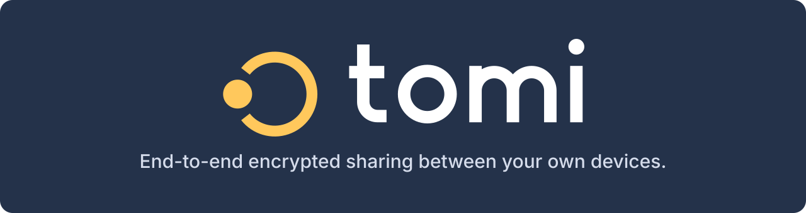

<p align="center">
  
</p>

<p align="center">
  <a href="https://github.com/tomi-share/tomi/actions/workflows/ci.yml"></a>
  <a href="LICENSE"></a>
  
  
</p>

**Tomi** is a private back-and-forth between *your own* devices. Copy a link, a note or a password on your
PC, and it shows up on your phone, with a notification, in seconds. Everything is end-to-end encrypted: the
relay in the middle is **blind** and only ever handles opaque bytes.

No account, no cloud drive, no "send to myself" chat to dig through. Just your devices and a relay you control.

## Highlights

- **End-to-end encrypted.** Content is encrypted and signed on your devices. The relay never sees content or keys.
- **Made for one person.** A *space* holds only your own devices. No accounts, recipients or per-device
  permissions in version 1.
- **Text, links, files and images.** Markdown and HTML are rendered safely (no network access from content).
- **Secrets stay secret.** Passwords can be hidden: the title is encrypted too, and revealing, copying or sharing one
  requires biometrics or Windows Hello. Copied secrets are wiped from the clipboard after 30 seconds.
- **Control how long it lives.** Never (the default), after reading, 1 hour, 1 day, 7 days or 30 days.
- **Pin, archive, search** across devices. Pins and archives sync like everything else.
- **Pair in seconds.** Scan a QR code or type a two-word code, then confirm a 6-digit verification code on both
  devices. New devices can receive your history, sealed for them alone.
- **Native on every platform.** Jetpack Compose on Android, SwiftUI with Liquid Glass on iOS, Tauri and Svelte on
  Windows. One shared Rust core for all the cryptography.
- **Self-hosted relay.** A single small Rust binary with its own storage, easy to run on a cheap VPS.

## How it works

<p align="center">
  
</p>

1. **Pair** your devices once. They share a secret space key that never leaves them.
2. **Send** something from any device. It is encrypted and signed locally, then handed to the relay.
3. **Receive** it on your other devices: the relay rings a doorbell over WebSocket, each device fetches the
   envelope and decrypts it locally.

The relay verifies signatures and routes envelopes, nothing more. Even if it is compromised, it holds nothing it
can read. The details are in [`PROJECT.md`](PROJECT.md) and in the [specification](spec/).

## Try it

| Platform | How to get it | Notes |
|---|---|---|
| Android | Latest [`android-dev`](https://github.com/tomi-share/tomi/releases/tag/android-dev) pre-release (`.apk`) | Development build, signed with the release key once the maintainer has configured it ([how it is checked](docs/RELEASES.md#android-release-signing)); never a debug build |
| Windows | Latest [`windows-dev`](https://github.com/tomi-share/tomi/releases/tag/windows-dev) pre-release (`.exe` installer) | Development build, unsigned (SmartScreen will warn) |
| iOS | Build from source (`apps/apple`) | TestFlight / App Store distribution is planned |
| Relay | [`relay-latest`](https://github.com/tomi-share/tomi/releases/tag/relay-latest) (Linux and Windows binaries) | Deployment guide in [`infra/`](infra/README.md) |

Tomi needs a relay to talk through. Follow [`infra/README.md`](infra/README.md) to run your own, then create your
space from the app's first screen and pair your other devices.

> The apps are in French for now (the default locale). Code, comments and documentation are in English.

## Project status

| Component | State |
|---|---|
| **Core** (`crates/core`) | Complete. The only implementation of the cryptography, the item format and sync, shared by every client through Rust or UniFFI. |
| **Relay** (`apps/relay`) | Implemented, with multi-space support. |
| **Android, Windows, iOS** | Built on the real core. Remaining differences between platforms are tracked in [`docs/FEATURES.md`](docs/FEATURES.md). |
| **CLI** (`crates/cli`) | Early stage. |
| **Mobile push** | Not implemented yet: clients are notified over WebSocket while the app is running. |

## Build from source

Prerequisites: Rust (via rustup) and [`just`](https://github.com/casey/just). Android builds also need the
Android SDK, NDK and `cargo-ndk`.

```sh
just build          # build the Rust workspace (core, cli, relay)
just dev-relay      # run the relay locally
just test           # run the workspace tests
just test-vectors   # check the specification test vectors (spec/vectors/)
```

See the [`justfile`](justfile) for the Android and Windows commands, and [`docs/DEV.md`](docs/DEV.md) for the
full developer guide.

## Repository layout

```
tomi/
  apps/
    relay/          # Rust: Axum + tokio-tungstenite + SQLx, the blind relay server
    windows/        # Rust + Tauri, Svelte frontend
    android/        # Kotlin + Jetpack Compose
    apple/          # SwiftUI (iOS)
  crates/
    core/           # Rust: crypto, item format, sync, local storage (+ UniFFI bindings)
    cli/            # Rust: the `tomi` command-line client (early stage)
  spec/             # Protocol and format specifications + frozen test vectors
  design/           # Visual identity (design tokens and assets)
  infra/            # Deployment (systemd, Caddy, install and update scripts)
  docs/             # Project framework, UX, feature matrix, developer guide
  justfile          # Single entry point for development commands
```

## Documentation

- [`PROJECT.md`](PROJECT.md): project framework, architecture and design decisions.
- [`spec/`](spec/): protocol, format and contract specifications, with frozen test vectors.
- [`docs/DEV.md`](docs/DEV.md): developer guide (setup, builds, releases).
- [`docs/FEATURES.md`](docs/FEATURES.md): feature matrix across platforms.
- [`design/tomi/brand-guidelines.md`](design/tomi/brand-guidelines.md): brand guidelines and assets.
- [`CONTRIBUTING.md`](CONTRIBUTING.md): how to contribute. Please follow the [Code of Conduct](CODE_OF_CONDUCT.md).
- [`SECURITY.md`](SECURITY.md): how to report a vulnerability (privately, not in a public issue).
- [`CHANGELOG.md`](CHANGELOG.md) and [`docs/RELEASES.md`](docs/RELEASES.md): what changed, and how releases are cut.
- [`docs/FORKING.md`](docs/FORKING.md): building and distributing your own version.

## License

Licensed under the Apache License, Version 2.0. See [`LICENSE`](LICENSE).
The name "Tomi" and the logo are not covered by that license, see [`TRADEMARKS.md`](TRADEMARKS.md).
