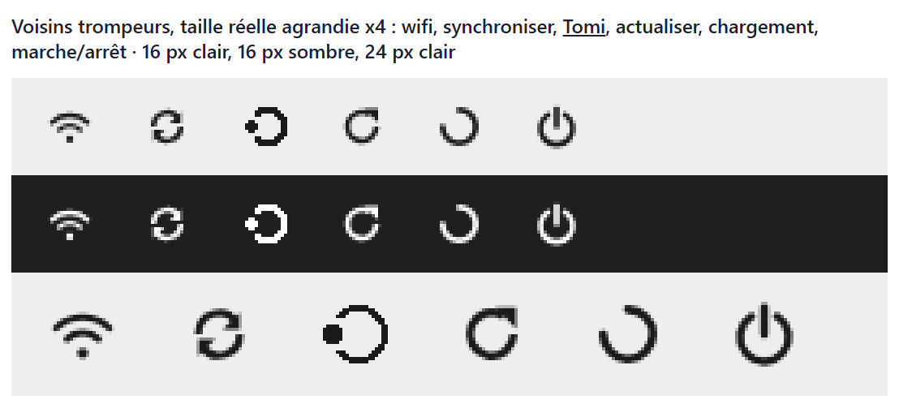
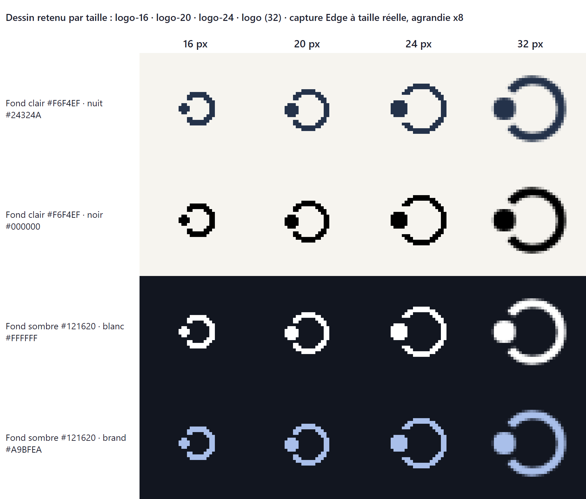
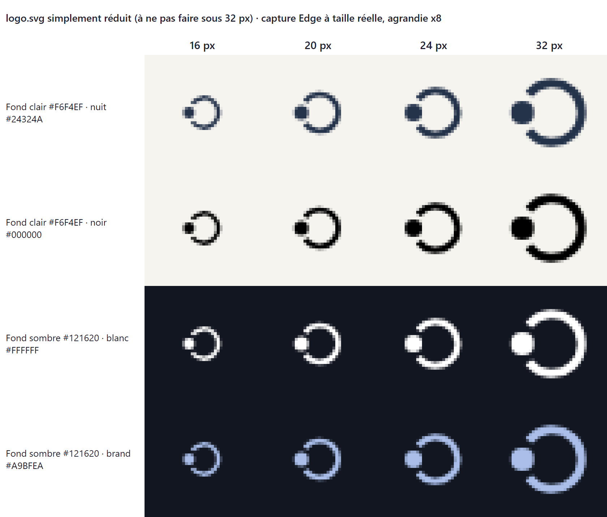
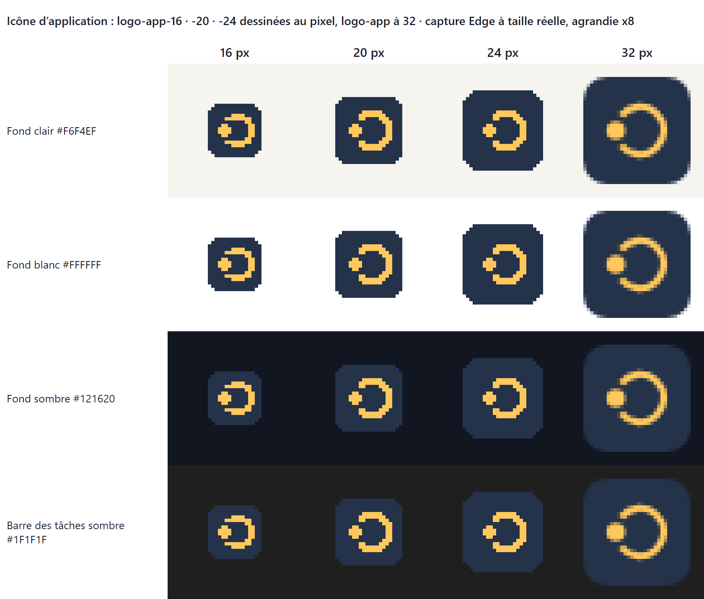
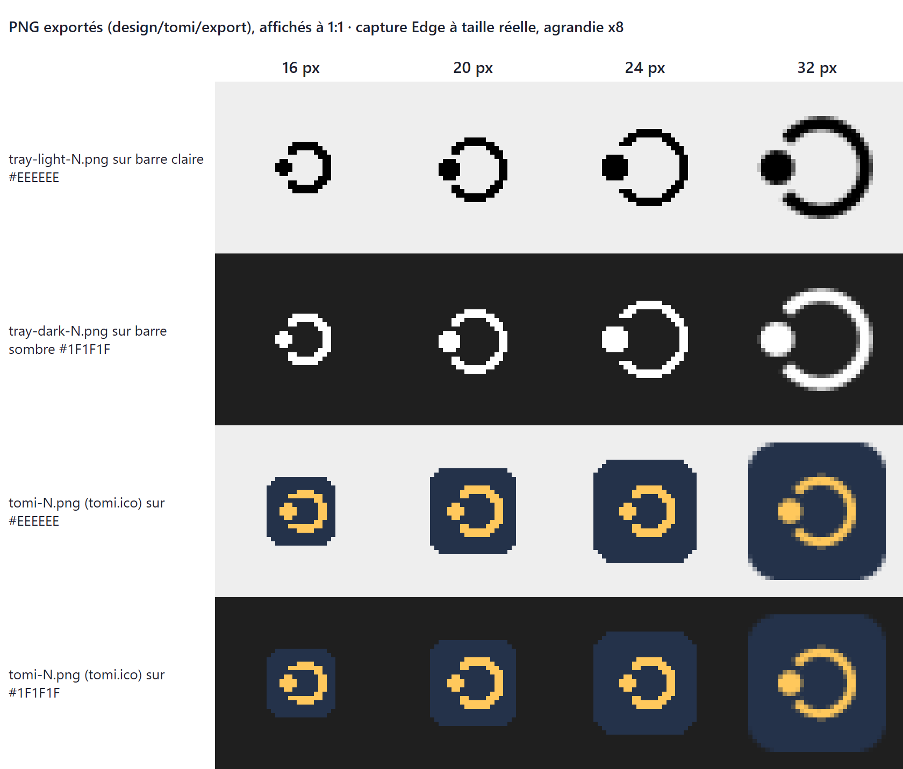
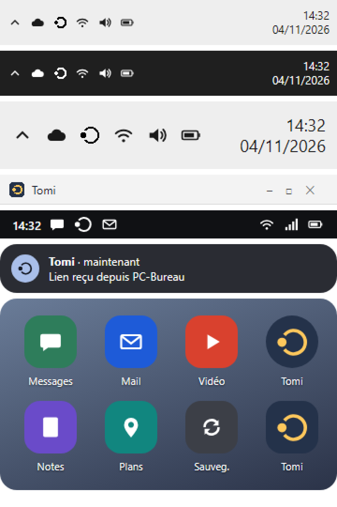

# Tomi — Brand guidelines

> Source of truth for values: [`tokens.json`](tokens.json). Source of truth for shapes: `design/build/tomi-geometry.mjs`,
> which generates every SVG in this folder. This document explains the choices; if the two ever disagree, those two files win.
> A PDF layout can be generated locally from this file with `design/build/tomi-build-pdf.mjs` (see [`README.md`](README.md));
> the PDF is not versioned.

## 1. The name and the idea

**Tomi**, from the English *to me*. The app lets you send things to yourself, from one device to another:
a link seen on the PC, a password to type on the phone, a photo to find again on the desktop.
The promise fits in one sentence: **everything you want to keep, always within reach.**

The identity is minimal and warm. Minimal because it is a personal tool, mostly seen at 16 px in a system tray.
Warm because the app handles intimate things (passwords, notes) and must inspire trust through calm rather than
through heavy security signals.

The name is written "Tomi" with a capital in running text. The wordmark is in lowercase: "tomi".
Never "TOMI", "ToMi" or "Tomi!".

## 2. The symbol

### 2.1 The idea

An open ring with a dot placed in its opening, on the line of the ring. The dot goes all the way round and returns to
its place: what you send comes back to you. The dot is you (the "me" of *to me*); the ring is the path between your devices.

<!-- pdf:symbole -->

This symbol was chosen from five candidates (loop, arches, "ti" ligature, boomerang, echo) after two external reviews
that ranked it first: it best expresses the return to oneself, it does not depend on the name written next to it, and it
works as an app icon, favicon or avatar.

### 2.2 Last refinement pass

The known risk of the loop was its resemblance to the "synchronise", "refresh" and "loading" icons, which sit right next
to it in the Windows tray. The final version addresses this through shape:

- **The dot becomes a bead.** Its diameter (64 out of 256) is 2.7 times the thickness of the ring (24). It sticks out of
  the ring on both the inside and the outside: you read an object sitting on the path, not the end of a stroke.
- **The ends of the ring are cut straight**, perpendicular to the stroke: no arrow head ("synchronise", "refresh"),
  no rounded end ("loading").
- **The opening is symmetric, on the left**, centred on the bead. The previous version, more open on one side,
  looked more like a spinning loading indicator.
- **The ring is thinner**, from 34 to 24 (out of 256), as a review requested, for more elegance at large sizes.
  At small sizes, the pixel drawings (2.4) guarantee the thickness.

Check: the symbol was rendered at real size next to generic "wifi", "synchronise", "refresh", "loading" and "power"
icons. At 16 and 24 px, the detached bead is the only motif of this kind in the row.
The look-alike variants tried during this pass (bead size and position, thickness) are not kept in the repository.

### 2.3 Construction

File: [`logo.svg`](logo.svg), viewBox `0 0 256 256`, two solid paths (ring, bead), `fill="currentColor"`.

<!-- pdf:construction -->

| Element | Value (units out of 256) |
|---|---|
| Centre of the ring | x 136, y 128 (shifted 8 to the right to balance the bead) |
| Ring | centreline radius 82, thickness 24 (radii 70 and 94) |
| Opening | from 142° to 218°, that is 38° on each side of the bead; straight, radial cuts |
| Bead | centre x 54, y 128 (on the centreline), radius 32 |
| Gap between the bead and the cuts | 18.8 units at the closest point (2.3 px at 32 px) |
| Bounding box | x 22 to 230, y 34 to 222 (208 x 188) |

### 2.4 Optical sizes

Below 32 px, shrinking `logo.svg` does not work: at 16 px the ring is only 1.5 px thick and turns grey, and the bead
blends into the ring. Three dedicated drawings, on integer coordinates with `shape-rendering="crispEdges"`, keep a solid
2 px stroke and a gap of at least 1 px around the bead: on screen, every pixel is either full or empty.

| Display size | File | Drawing |
|---|---|---|
| 16 px | [`logo-16.svg`](logo-16.svg) | 12 px ring, 2 px stroke, 4 px bead, 1 px gap |
| 20 px | [`logo-20.svg`](logo-20.svg) | 15 px ring, 2 px stroke, 5 px bead, 1 px gap |
| 24 px | [`logo-24.svg`](logo-24.svg) | 18 px ring, 2 px stroke, 6 px bead, 2 px gap |
| 32 px and up | [`logo.svg`](logo.svg) | reference drawing (2.3) |

Thresholds observed on the real renders below: `logo.svg` is sharp from 32 px (3 px stroke); at 24 px it stays
legible but soft; at 20 and 16 px it no longer is. For an in-between size (28 px, for example), use the next drawn size
up and let the system scale the whole image down; never enlarge a pixel drawing.

<!-- pdf:grilles -->

The app icon has its own pixel drawings for 16, 20 and 24 px (`logo-app-16.svg`, `logo-app-20.svg`,
`logo-app-24.svg`): the night tile and the sun symbol are redrawn so that the symbol keeps a 2 px stroke.

The real-size captures (`*-actual.png`) are in the same folder, `design/tomi/proofs/`.

### 2.5 Animation

The bead makes one full lap and returns to its place: 1,200 ms, easing `cubic-bezier(0.65, 0, 0.35, 1)` (soft start and
end). The ring does not move. Demonstration file: [`logo-anime.svg`](logo-anime.svg) (it loops with a 1,200 ms rest).

<!-- pdf:animation -->

Rules:

- A single lap, triggered by an event: on first launch, at the end of a pairing, when content arrives while the window is
  open. Never looping inside the app.
- **Never as a loading or waiting indicator**: that is exactly the confusion the drawing avoids. For a wait, use a
  linear progress bar.
- If the system asks for reduced motion (`prefers-reduced-motion`, "Remove animations" on Android), do not play the lap.
  The demonstration file respects this setting.

## 3. Wordmark and lockups

### 3.1 Wordmark

"tomi" in lowercase, drawn letters (no font, no `<text>` element: the rendering depends on nothing installed).
File: [`logo-wordmark.svg`](logo-wordmark.svg). Geometric construction, x-height 100, stroke 22; the `o` is a closed ring (the
symbol's ring is open), the foot of the `t` follows the curve of the ring, and the dot of the `i` is round like the bead.

### 3.2 Lockups

<!-- pdf:assemblages -->

| File | Use |
|---|---|
| [`logo-horizontal.svg`](logo-horizontal.svg) | Main lockup: symbol at 0.8 (ring 1.5 x-heights high), then the wordmark; a single `currentColor` fill |
| [`logo-stacked.svg`](logo-stacked.svg) | Symbol above the wordmark, for square formats (splash screen, about page) |
| [`logo-horizontal-on-night.svg`](logo-horizontal-on-night.svg) | Colour version, on the night background only: sun symbol, white wordmark |
| [`logo-app.svg`](logo-app.svg) | App icon: night tile with rounded corners (radius 22 % of the side), sun symbol at 0.7 |

### 3.3 Clear space and minimum sizes

- **Clear space**: the diameter of the bead all around the symbol or lockup (64 units out of 256 for the symbol, that is
  31 % of its width). Nothing in this zone: text, screen edge, another logo.
- **Symbol alone**: 16 px minimum, with the drawing for that size (2.4).
- **Horizontal lockup**: 24 px high minimum (x-height about 14 px). Below that, use the symbol alone.
- **Stacked lockup**: 64 px high minimum.

## 4. Colours

### 4.1 Identity: night and sun

<!-- pdf:identite -->

- **Night `#24324A`**: a deep midnight blue. Background of the app icon, the splash screen and store visuals;
  colour of the logo on light backgrounds.
- **Sun `#FFC85C`**: a warm yellow. **Reserved for the symbol placed on the night background** (8.38:1). Never on a light
  background (1.40:1, illegible), never for text, a button or a state. This rarity is what makes it recognisable.
- The wordmark next to the sun symbol is **white**, not yellow.

### 4.2 Interface

The interface stays almost monochrome. The interface "brand blue" (`brand`) is the same hue as the identity's night,
lighter so that it stands apart from the text. The status colours (ochre, plum, green, red) are carried over as they
were from the earlier palette: they had been validated and do not compete with the identity. The ochre of waiting states
is deliberately more muted than the sun.

<!-- pdf:swatches -->

**Light mode**

| Token | Hex | Usage |
|---|---|---|
| `color.light.bg` | `#F6F4EF` | Window / screen background (cream) |
| `color.light.surface` | `#FFFFFF` | Cards, popover, bottom sheet, fields |
| `color.light.surface-alt` | `#ECE9E2` | Headers, hovered row, code block, revealed password |
| `color.light.text` | `#1B2130` | Main text |
| `color.light.text-muted` | `#565C6B` | Metadata, expired item |
| `color.light.border` | `#D5D1C7` | Separators (decorative) |
| `color.light.border-strong` | `#858996` | Outline of fields and controls |
| `color.light.brand` | `#2E4C80` | Primary button, links, unread dot, focus |
| `color.light.on-brand` | `#FFFFFF` | Text on the primary button |
| `color.light.brand-container` | `#E3E9F4` | Active filter, selected chip |
| `color.light.secondary` | `#8C5F14` | Waiting, offline, Cancel, highlight |
| `color.light.secret` | `#6F4F7C` | Hidden-content marker |
| `color.light.secret-container` | `#EFE8F1` | Background of the hidden block |
| `color.light.success` | `#2E6B45` | Delivered, Sent |
| `color.light.error` | `#B3261E` | Errors only |

**Dark mode**

| Token | Hex | Usage |
|---|---|---|
| `color.dark.bg` | `#121620` | Window / screen background |
| `color.dark.surface` | `#1A1F2B` | Cards, popover, bottom sheet, fields |
| `color.dark.surface-alt` | `#242A38` | Headers, hovered row, code block, revealed password |
| `color.dark.text` | `#E9E7E1` | Main text |
| `color.dark.text-muted` | `#A6ABB8` | Metadata, expired item |
| `color.dark.border` | `#383E4C` | Separators (decorative) |
| `color.dark.border-strong` | `#6F7587` | Outline of fields and controls |
| `color.dark.brand` | `#A9BFEA` | Primary button, links, unread dot, focus |
| `color.dark.on-brand` | `#121620` | Text on the primary button |
| `color.dark.brand-container` | `#24324A` | Active filter, selected chip (= night) |
| `color.dark.secondary` | `#E0B160` | Waiting, offline, Cancel, highlight |
| `color.dark.secret` | `#CDB3D9` | Hidden-content marker |
| `color.dark.secret-container` | `#2E2636` | Background of the hidden block |
| `color.dark.success` | `#8FCFA6` | Delivered, Sent |
| `color.dark.error` | `#F2B8B5` | Errors only |

### 4.3 Contrast (WCAG 2.x)

Method (WCAG 2.2): each channel `c = v / 255` is linearised (`c / 12.92` if `c <= 0.04045`, otherwise `((c + 0.055) / 1.055) ^ 2.4`),
the luminance is `L = 0.2126 R + 0.7152 G + 0.0722 B`, and the contrast is `(L_lighter + 0.05) / (L_darker + 0.05)`.
Thresholds: **4.5:1** for text (criterion 1.4.3), **3:1** for component outlines and graphic elements such as the logo
(criterion 1.4.11). Values produced by `node tomi-contrasts.mjs` (exit code 1 if a pair fails).

**Relative luminances**

| Token | Hex | R_lin | G_lin | B_lin | L |
|---|---|---|---|---|---|
| light.text | #1B2130 | 0.0110 | 0.0152 | 0.0296 | 0.0153 |
| light.bg | #F6F4EF | 0.9216 | 0.9047 | 0.8632 | 0.9053 |
| light.surface | #FFFFFF | 1.0000 | 1.0000 | 1.0000 | 1.0000 |
| light.surface-alt | #ECE9E2 | 0.8388 | 0.8148 | 0.7605 | 0.8160 |
| light.text-muted | #565C6B | 0.0931 | 0.1070 | 0.1470 | 0.1069 |
| light.brand | #2E4C80 | 0.0273 | 0.0723 | 0.2159 | 0.0731 |
| light.brand-container | #E3E9F4 | 0.7682 | 0.8148 | 0.9047 | 0.8114 |
| light.secondary | #8C5F14 | 0.2623 | 0.1144 | 0.0070 | 0.1381 |
| light.secret | #6F4F7C | 0.1590 | 0.0782 | 0.2016 | 0.1043 |
| light.secret-container | #EFE8F1 | 0.8632 | 0.8070 | 0.8796 | 0.8241 |
| light.success | #2E6B45 | 0.0273 | 0.1470 | 0.0595 | 0.1153 |
| light.error | #B3261E | 0.4508 | 0.0194 | 0.0130 | 0.1106 |
| light.border-strong | #858996 | 0.2346 | 0.2502 | 0.3050 | 0.2508 |
| light.border | #D5D1C7 | 0.6654 | 0.6376 | 0.5711 | 0.6387 |
| dark.text | #E9E7E1 | 0.8148 | 0.7991 | 0.7529 | 0.7991 |
| dark.bg | #121620 | 0.0060 | 0.0080 | 0.0144 | 0.0081 |
| dark.surface | #1A1F2B | 0.0103 | 0.0137 | 0.0242 | 0.0137 |
| dark.surface-alt | #242A38 | 0.0176 | 0.0232 | 0.0395 | 0.0232 |
| dark.text-muted | #A6ABB8 | 0.3813 | 0.4072 | 0.4793 | 0.4069 |
| dark.brand | #A9BFEA | 0.3968 | 0.5210 | 0.8228 | 0.5164 |
| dark.brand-container | #24324A | 0.0176 | 0.0319 | 0.0685 | 0.0315 |
| dark.secondary | #E0B160 | 0.7454 | 0.4397 | 0.1170 | 0.4814 |
| dark.secret | #CDB3D9 | 0.6105 | 0.4508 | 0.6939 | 0.5023 |
| dark.secret-container | #2E2636 | 0.0273 | 0.0194 | 0.0369 | 0.0223 |
| dark.success | #8FCFA6 | 0.2747 | 0.6240 | 0.3813 | 0.5322 |
| dark.error | #F2B8B5 | 0.8879 | 0.4793 | 0.4621 | 0.5649 |
| dark.border-strong | #6F7587 | 0.1590 | 0.1779 | 0.2423 | 0.1785 |
| dark.border | #383E4C | 0.0395 | 0.0482 | 0.0723 | 0.0481 |
| identity.sun | #FFC85C | 1.0000 | 0.5776 | 0.1070 | 0.6334 |
| identity.night | #24324A | 0.0176 | 0.0319 | 0.0685 | 0.0315 |

**Contrast, light mode**

| Foreground | Background | Calculation | Ratio | Threshold | Verdict |
|---|---|---|---|---|---|
| text #1B2130 | bg #F6F4EF | (0.9053+0.05)/(0.0153+0.05) | 14.62:1 | 4.5 | OK |
| text #1B2130 | surface #FFFFFF | (1.0000+0.05)/(0.0153+0.05) | 16.07:1 | 4.5 | OK |
| text #1B2130 | surface-alt #ECE9E2 | (0.8160+0.05)/(0.0153+0.05) | 13.25:1 | 4.5 | OK |
| text-muted #565C6B | bg #F6F4EF | (0.9053+0.05)/(0.1069+0.05) | 6.09:1 | 4.5 | OK |
| text-muted #565C6B | surface #FFFFFF | (1.0000+0.05)/(0.1069+0.05) | 6.69:1 | 4.5 | OK |
| text-muted #565C6B | surface-alt #ECE9E2 | (0.8160+0.05)/(0.1069+0.05) | 5.52:1 | 4.5 | OK |
| brand #2E4C80 | bg #F6F4EF | (0.9053+0.05)/(0.0731+0.05) | 7.76:1 | 4.5 | OK |
| brand #2E4C80 | surface #FFFFFF | (1.0000+0.05)/(0.0731+0.05) | 8.53:1 | 4.5 | OK |
| brand #2E4C80 | surface-alt #ECE9E2 | (0.8160+0.05)/(0.0731+0.05) | 7.04:1 | 4.5 | OK |
| on-brand #FFFFFF | brand #2E4C80 | (1.0000+0.05)/(0.0731+0.05) | 8.53:1 | 4.5 | OK |
| brand #2E4C80 | brand-container #E3E9F4 | (0.8114+0.05)/(0.0731+0.05) | 7.00:1 | 4.5 | OK |
| text #1B2130 | brand-container #E3E9F4 | (0.8114+0.05)/(0.0153+0.05) | 13.18:1 | 4.5 | OK |
| secondary #8C5F14 | bg #F6F4EF | (0.9053+0.05)/(0.1381+0.05) | 5.08:1 | 4.5 | OK |
| secondary #8C5F14 | surface #FFFFFF | (1.0000+0.05)/(0.1381+0.05) | 5.58:1 | 4.5 | OK |
| secondary #8C5F14 | surface-alt #ECE9E2 | (0.8160+0.05)/(0.1381+0.05) | 4.60:1 | 4.5 | OK (thin margin) |
| secret #6F4F7C | bg #F6F4EF | (0.9053+0.05)/(0.1043+0.05) | 6.19:1 | 4.5 | OK |
| secret #6F4F7C | surface #FFFFFF | (1.0000+0.05)/(0.1043+0.05) | 6.81:1 | 4.5 | OK |
| secret #6F4F7C | surface-alt #ECE9E2 | (0.8160+0.05)/(0.1043+0.05) | 5.61:1 | 4.5 | OK |
| secret #6F4F7C | secret-container #EFE8F1 | (0.8241+0.05)/(0.1043+0.05) | 5.67:1 | 4.5 | OK |
| text #1B2130 | secret-container #EFE8F1 | (0.8241+0.05)/(0.0153+0.05) | 13.38:1 | 4.5 | OK |
| success #2E6B45 | bg #F6F4EF | (0.9053+0.05)/(0.1153+0.05) | 5.78:1 | 4.5 | OK |
| success #2E6B45 | surface #FFFFFF | (1.0000+0.05)/(0.1153+0.05) | 6.35:1 | 4.5 | OK |
| success #2E6B45 | surface-alt #ECE9E2 | (0.8160+0.05)/(0.1153+0.05) | 5.24:1 | 4.5 | OK |
| error #B3261E | bg #F6F4EF | (0.9053+0.05)/(0.1106+0.05) | 5.95:1 | 4.5 | OK |
| error #B3261E | surface #FFFFFF | (1.0000+0.05)/(0.1106+0.05) | 6.54:1 | 4.5 | OK |
| error #B3261E | surface-alt #ECE9E2 | (0.8160+0.05)/(0.1106+0.05) | 5.39:1 | 4.5 | OK |
| border-strong #858996 | bg #F6F4EF | (0.9053+0.05)/(0.2508+0.05) | 3.18:1 | 3 | OK (thin margin) |
| border-strong #858996 | surface #FFFFFF | (1.0000+0.05)/(0.2508+0.05) | 3.49:1 | 3 | OK |
| border #D5D1C7 | bg #F6F4EF | (0.9053+0.05)/(0.6387+0.05) | 1.39:1 | — | decorative |
| border #D5D1C7 | surface #FFFFFF | (1.0000+0.05)/(0.6387+0.05) | 1.52:1 | — | decorative |

**Contrast, dark mode**

| Foreground | Background | Calculation | Ratio | Threshold | Verdict |
|---|---|---|---|---|---|
| text #E9E7E1 | bg #121620 | (0.7991+0.05)/(0.0081+0.05) | 14.62:1 | 4.5 | OK |
| text #E9E7E1 | surface #1A1F2B | (0.7991+0.05)/(0.0137+0.05) | 13.32:1 | 4.5 | OK |
| text #E9E7E1 | surface-alt #242A38 | (0.7991+0.05)/(0.0232+0.05) | 11.61:1 | 4.5 | OK |
| text-muted #A6ABB8 | bg #121620 | (0.4069+0.05)/(0.0081+0.05) | 7.87:1 | 4.5 | OK |
| text-muted #A6ABB8 | surface #1A1F2B | (0.4069+0.05)/(0.0137+0.05) | 7.17:1 | 4.5 | OK |
| text-muted #A6ABB8 | surface-alt #242A38 | (0.4069+0.05)/(0.0232+0.05) | 6.25:1 | 4.5 | OK |
| brand #A9BFEA | bg #121620 | (0.5164+0.05)/(0.0081+0.05) | 9.75:1 | 4.5 | OK |
| brand #A9BFEA | surface #1A1F2B | (0.5164+0.05)/(0.0137+0.05) | 8.89:1 | 4.5 | OK |
| brand #A9BFEA | surface-alt #242A38 | (0.5164+0.05)/(0.0232+0.05) | 7.74:1 | 4.5 | OK |
| on-brand #121620 | brand #A9BFEA | (0.5164+0.05)/(0.0081+0.05) | 9.75:1 | 4.5 | OK |
| brand #A9BFEA | brand-container #24324A | (0.5164+0.05)/(0.0315+0.05) | 6.95:1 | 4.5 | OK |
| text #E9E7E1 | brand-container #24324A | (0.7991+0.05)/(0.0315+0.05) | 10.42:1 | 4.5 | OK |
| secondary #E0B160 | bg #121620 | (0.4814+0.05)/(0.0081+0.05) | 9.15:1 | 4.5 | OK |
| secondary #E0B160 | surface #1A1F2B | (0.4814+0.05)/(0.0137+0.05) | 8.34:1 | 4.5 | OK |
| secondary #E0B160 | surface-alt #242A38 | (0.4814+0.05)/(0.0232+0.05) | 7.26:1 | 4.5 | OK |
| secret #CDB3D9 | bg #121620 | (0.5023+0.05)/(0.0081+0.05) | 9.51:1 | 4.5 | OK |
| secret #CDB3D9 | surface #1A1F2B | (0.5023+0.05)/(0.0137+0.05) | 8.66:1 | 4.5 | OK |
| secret #CDB3D9 | surface-alt #242A38 | (0.5023+0.05)/(0.0232+0.05) | 7.55:1 | 4.5 | OK |
| secret #CDB3D9 | secret-container #2E2636 | (0.5023+0.05)/(0.0223+0.05) | 7.64:1 | 4.5 | OK |
| text #E9E7E1 | secret-container #2E2636 | (0.7991+0.05)/(0.0223+0.05) | 11.74:1 | 4.5 | OK |
| success #8FCFA6 | bg #121620 | (0.5322+0.05)/(0.0081+0.05) | 10.03:1 | 4.5 | OK |
| success #8FCFA6 | surface #1A1F2B | (0.5322+0.05)/(0.0137+0.05) | 9.13:1 | 4.5 | OK |
| success #8FCFA6 | surface-alt #242A38 | (0.5322+0.05)/(0.0232+0.05) | 7.96:1 | 4.5 | OK |
| error #F2B8B5 | bg #121620 | (0.5649+0.05)/(0.0081+0.05) | 10.59:1 | 4.5 | OK |
| error #F2B8B5 | surface #1A1F2B | (0.5649+0.05)/(0.0137+0.05) | 9.65:1 | 4.5 | OK |
| error #F2B8B5 | surface-alt #242A38 | (0.5649+0.05)/(0.0232+0.05) | 8.40:1 | 4.5 | OK |
| border-strong #6F7587 | bg #121620 | (0.1785+0.05)/(0.0081+0.05) | 3.94:1 | 3 | OK |
| border-strong #6F7587 | surface #1A1F2B | (0.1785+0.05)/(0.0137+0.05) | 3.59:1 | 3 | OK |
| border #383E4C | bg #121620 | (0.0481+0.05)/(0.0081+0.05) | 1.69:1 | — | decorative |
| border #383E4C | surface #1A1F2B | (0.0481+0.05)/(0.0137+0.05) | 1.54:1 | — | decorative |

**Contrast, identity**

| Foreground | Background | Calculation | Ratio | Threshold | Verdict |
|---|---|---|---|---|---|
| identity.sun #FFC85C | identity.night #24324A | (0.6334+0.05)/(0.0315+0.05) | 8.38:1 | 3 | OK |
| white #FFFFFF | identity.night #24324A | (1.0000+0.05)/(0.0315+0.05) | 12.88:1 | 4.5 | OK |
| identity.night #24324A | light.bg #F6F4EF | (0.9053+0.05)/(0.0315+0.05) | 11.72:1 | 3 | OK |
| identity.night #24324A | light.surface #FFFFFF | (1.0000+0.05)/(0.0315+0.05) | 12.88:1 | 3 | OK |
| identity.night #24324A | dark.bg #121620 | (0.0315+0.05)/(0.0081+0.05) | 1.40:1 | — | forbidden |
| identity.sun #FFC85C | light.bg #F6F4EF | (0.9053+0.05)/(0.6334+0.05) | 1.40:1 | — | forbidden |
| dark.brand #A9BFEA | dark.bg #121620 | (0.5164+0.05)/(0.0081+0.05) | 9.75:1 | 3 | OK |

Rules that follow from the numbers:

- The ochre `secondary` text (light mode) on `surface-alt` is a narrow pass (4.60:1): place it preferably on `bg` or `surface`.
- `border-strong` (light mode) on `bg` is a narrow pass (3.18:1): do not lighten it.
- The night logo on a dark background is invisible (1.40:1): in dark mode, the logo is white or `dark.brand`.
- Never put `secondary`, `secret`, `success` or `error` text on a `brand` background (pairs not validated).

## 5. Typography

| Role | Family | Licence | Where to get it |
|---|---|---|---|
| Interface | **Inter** (Rasmus Andersson), variable `opsz` 14–32 and `wght` 100–900 | SIL OFL 1.1 | [`../fonts/`](../fonts/), [github.com/rsms/inter](https://github.com/rsms/inter) |
| Content mono | **JetBrains Mono**, variable `wght` 100–800 | SIL OFL 1.1 | [`../fonts/`](../fonts/), [github.com/JetBrains/JetBrainsMono](https://github.com/JetBrains/JetBrainsMono) |

Inter is designed for screens, legible at 12 px, and its sober geometry suits the wordmark without copying it: the
"tomi" wordmark is never re-set in Inter. JetBrains Mono gives a distinct form to each ambiguous glyph (dotted 0, l, I, 1);
for a revealed password, add `font-feature-settings: "zero" 1`. Fonts are embedded in the apps, never loaded over the
network. Fallbacks: `Segoe UI Variable` / `Segoe UI` (Windows), `Roboto` (Android), `Cascadia Mono` / `Consolas` (mono).

<!-- pdf:type-specimen -->

| Style | Family | Size / line height | Weight | Usage |
|---|---|---|---|---|
| Title | Inter | 20 / 26 | 600 | Screen title, bottom-sheet title |
| Subtitle | Inter | 16 / 22 | 600 | Section title, device name |
| Body | Inter | 15 / 22 | 400 | Card preview, item text, fields |
| Label | Inter | 14 / 20 | 500 | Buttons, chips, filters, menus |
| Caption | Inter | 12 / 16 | 400 | Device, time, size, status. Minimum size |
| Mono | JetBrains Mono | 14 / 20 | 400 | URL, code, file name, revealed password |
| Pairing code | JetBrains Mono | 28 | 600 | The 6 verification digits, tabular figures |

Sizes in px (Windows) = sp (Android). Times, sizes and counters: `font-feature-settings: "tnum" 1`.

## 6. Icons

### 6.1 Style

One icon set on both platforms: **Material Symbols Outlined** (Google, Apache 2.0), `FILL 0`, `wght 400`, `GRAD 0`,
`opsz` equal to the displayed size. The filled style (`FILL 1`) is reserved for the selected state and the unread dot.
Sizes: 16 px (metadata), 20 px (card type, Windows popover buttons), 24 px (Android action bars).
Colour: `text-muted` by default, `text` on hover or when active. Native Windows fallback (tray menu): Fluent UI System Icons Regular.

### 6.2 Mapping

<!-- pdf:icons -->

| Meaning | Material Symbols | Colour |
|---|---|---|
| Link | `link` | text-muted |
| Text | `notes` | text-muted |
| Markdown | `markdown` | text-muted |
| File | `draft` | text-muted |
| Image | `image` | text-muted |
| Hidden | `visibility_off` | secret |
| Show | `visibility` | text |
| Unread | `fiber_manual_record`, FILL 1 | brand |
| Sent | `check` | text-muted |
| Delivered | `done_all` | success |
| Waiting / offline | `schedule` | secondary |
| Expired | `timer_off` | text-muted |
| Unreadable / failed | `error` | error |

No padlock on hidden content: everything is encrypted, and a padlock on some items would suggest that the others are not.

### 6.3 What is specific to Tomi

- **No circular-arrow icon** (`sync`, `autorenew`, `refresh`, `cached`) next to the logo, nor in the header where it
  appears: it would give the symbol back the confusion its drawing avoids. For "refresh", prefer the gesture (pull to
  refresh) or a label.
- **No circular progress indicator** in the app: linear bar only (see 2.5).
- The symbol is never used as an action icon (a "send to me" button, for example): it is a signature.

## 7. Tone and vocabulary

The UI copy is in French, the default locale. The examples below are quoted as they appear in the app.

- **Impersonal first, informal "tu" when a sentence is needed.** Buttons use the infinitive ("Envoyer", "Coller",
  "Supprimer partout"); states use nouns or participles ("Envoyé", "Livré", "Hors ligne · en attente"). A sentence uses
  "tu": the tool is one you write to yourself, and the formal "vous" would sound like a customer-service script.
- **Short**: buttons of 1 to 3 words, toasts of 2 to 5 words, help sentence of 15 words at most. One piece of information per message.
  No full stop in buttons and toasts. Separator: middle dot with spaces around it ("Envoyé · Annuler").
- **French typography**: non-breaking space before `: ; ? !`, guillemets « », times `14:02`, sizes `2,4 Mo`.
- **"Secret" content**: the code keeps the name `secret`, the screen says **"Masqué"** (hidden) (badge, "Masqués" filter,
  "Masquer le contenu" toggle, closed card "•••••• Afficher", after copying "Copié · effacé dans 30 s", notification
  "Contenu masqué · PC-Bureau", never a preview).

| Situation | Say | Avoid |
|---|---|---|
| Send succeeded | « Envoyé · Annuler » | « Votre contenu a été envoyé avec succès ! » |
| Offline | « Hors ligne · en attente » | « Erreur réseau » |
| Unreadable item | « Illisible sur cet appareil » | « Échec critique du déchiffrement » |
| First launch | « Aucun appareil appairé » / « Créer mon espace » | « Bienvenue dans Tomi ! » followed by an emoji |
| Pairing | « Vérifie que le même code s'affiche sur les deux appareils. » | « Attention : risque d'attaque ! » |

## 8. Ready-made files and rules for developers

`design/build/tomi-export.mjs` generates the SVGs in this folder and everything under `export/` (see [`README.md`](README.md)).
Never edit them by hand: change `tomi-geometry.mjs` or `tokens.json`, then run the script again.

| File | Content |
|---|---|
| `export/tomi.ico`, `export/tomi-<N>.png` | Windows app icon (night tile, sun symbol); 16, 20, 24 drawn at the pixel, 32, 48, 256 as vectors |
| `export/tray-light.ico`, `tray-light-<N>.png` | Notification area on a light taskbar: black symbol; N = 16, 20, 24, 32 |
| `export/tray-dark.ico`, `tray-dark-<N>.png` | Dark taskbar: white symbol; N = 16, 20, 24, 32 |
| `export/android/ic_stat_tomi.xml` | Notification icon (status bar), 24 dp, a single white fill |
| `export/android/ic_launcher*.xml` | Adaptive icon: sun foreground, night background, monochrome layer, `adaptive-icon` declaration |
| `export/store/tomi-play-512.png` | Google Play icon, 512 x 512, full square (the store applies its mask) |

#### Windows

- **Tray**: choose `tray-light` or `tray-dark` according to the theme **of the taskbar** (`SystemUsesLightTheme`), not the app's
  theme, and reload it when that theme changes. Size = 16 px x the screen scale: 100 % → 16, 125 % → 20, 150 % → 24,
  200 % → 32; for 175 %, use 32. No brand colour in the tray (system icons are monochrome).
- **Executable, shortcut, title bar, taskbar**: `tomi.ico`. The night tile stays visible on both light and dark backgrounds.

#### Android

- **Notification**: `ic_stat_tomi.xml` as the small icon (`setSmallIcon`). Android keeps only the transparency and applies the
  tint itself: do not put a colour in it. `setColor` receives `color.light.brand` (`#2E4C80`).
- **App icon**: `ic_launcher.xml` in `res/mipmap-anydpi-v26/` (also under the name `ic_launcher_round.xml`),
  `ic_launcher_foreground.xml` and `ic_launcher_monochrome.xml` in `res/drawable/`, `ic_launcher_background.xml` in
  `res/values/`. The symbol occupies 41 dp of the 72 dp visible area; its farthest point is 20.5 dp from the centre (safe
  circle: 33 dp). The monochrome layer serves the themed icons of Android 13+.
- **Splash screen** (Android 12+): `windowSplashScreenBackground` = night, `windowSplashScreenAnimatedIcon` =
  `@drawable/ic_launcher_foreground`. The animated version (AnimatedVectorDrawable of the bead's lap) is not produced yet.

#### Everywhere

- Never shrink `logo.svg` below 32 px, and never resize a pixel drawing (`logo-16/20/24`, `logo-app-16/20/24`) to a size
  other than its own. For an unplanned size, add a drawing in `tomi-geometry.mjs` and re-run the export.
- After any change: `node tomi-export.mjs` (it fails if a pixel render is not crisp, if a colour drifts from
  `tokens.json`, or if the adaptive icon leaves the safe zone), then `node tomi-proofs.mjs`, and look at the renders.

## 9. Logo usage rules

- **Allowed colours**: night on a light background; white or `dark.brand` on a dark background; pure black or white in
  monochrome; sun only on the night background, with the wordmark in white. Always flat fills.
- **Backgrounds**: plain light, plain dark or night. On a photo or a busy background, place the logo on a `surface` or night chip.

<!-- pdf:interdits -->

Do not:

- close the ring, or move the bead out of the opening (except during the animation);
- round the cuts of the ring or add an arrow head;
- change the proportions (thicker ring, bead smaller than twice the stroke);
- stretch, skew or rotate the symbol (rotated, it reads as a "G" or a "power" icon);
- use two colours, a gradient, a shadow, an outline or an emboss on the symbol;
- place the sun on a light background, or write in sun yellow;
- re-set the wordmark in a font, even Inter;
- use the symbol as a loading indicator.

## 10. Decisions made and open points

Choices made without explicit instructions:

- Status colours (ochre, plum, green, red) are carried over from the earlier palette, with the same token names: an app
  can switch by replacing only `tokens.json`.
- Inter and JetBrains Mono are kept for the interface; the wordmark is drawn separately.
- The Windows app icon is a night tile (not the symbol alone): a night symbol on transparency would disappear on a dark taskbar.
- A pixel drawing is also used at 20 px: shrinking `logo.svg` to 20 px is soft (a 1.9 px stroke renders grey).

Open points:

- **The name is not verified**: trademarks, app stores, domain names. Tomi is a common given name (Finland, Japan,
  Hungary), so conflicts are likely. To be checked before any public release.
- Real rendering is not verified in the tray of a physical Windows 11 machine nor in a phone's status bar: the proofs are
  real-size simulations rendered by Edge.
